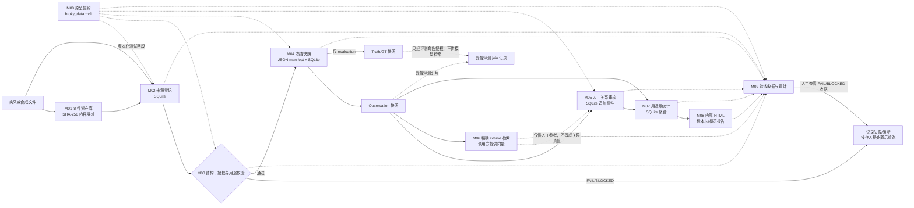

# 总体架构与数据流

**文档范围：** 描述本仓库当前可运行的测试期原型。代码使用 `broky_data.*.v1` 本地原型契约；它不是 RelicWeave/MEHR 的正式 schema，也不代表生产部署方案。

## 当前数据流

虚线表示审计/受控评测关联，不表示将 Truth/GT 暴露给普通流程。`demo` 使用合成记录演练接入、审核、快照、关系、检索、统计、输出和验收。

## 模块实现边界

| 模块 | 当前测试期实现 | 尚未实现或不可据此推定 |
|---|---|---|
| M00 契约 | `broky_data.*.v1` 原型对象和 JSON 版本标记 | 与 RelicWeave/MEHR 正式 schema 的映射或签收 |
| M01 资产 | 本地 SHA-256 文件对象；Observation/Truth 分目录 | 生产对象存储、加密、备份、独立 ACL |
| M02 登记 | SQLite 来源记录、人工资格/授权状态 | Arches、OpenRefine、真实身份/法律权利核验 |
| M03 校验 | 标准库字段、hash、用途、分区和部分资格门禁 | 图像/3D 解析、考古/物理真实性判断 |
| M04 快照 | JSON manifest、opaque member ID、评测 join 记录 | Parquet/DVC、split 生成、独立 Truth 安全域 |
| M05 关系 | SQLite 人工决策历史；R2 双向直接记录，不推导传递关系 | 完整 MEHR 证据闭包及 Arches 往返映射 |
| M06 检索 | SQLite 小规模精确 cosine 索引 | 向量模型、FAISS、生产规模性能保证 |
| M07 统计 | SQLite 用途级分类与结果分母汇总 | DuckDB/Superset、已签收业务指标和披露策略 |
| M08 输出 | 内部 HTML 标本卡与统计概览 | 批准模板、PDF、图版排版或公开发布 |
| M09 验收 | JSON 质量/功能收据、本地哈希链 | 数字签名、独立不可变审计、正式签署流程 |

## 存储与信任边界

- 一处本地数据根目录内含 SQLite 元数据、Observation/Truth 分开的资产目录、快照和收据；POSIX 下管理目录为 `700`、数据库与资产文件为 `600`。
- CLI 身份通过 `--actor`/`--role` 提供。应用角色仅用于测试工作流，可被本机调用者伪造；目录分区和 ACL 不构成跨账户、跨主机或密钥级隔离。
- SHA-256 用于内容完整性和去重，不证明来源、授权或真实性。审计哈希链可发现一般改写，但有数据库写权限者仍可重写整链。
- Truth/GT 在原型中单独分区，快照仅限 evaluation，普通 model 角色不能读取；这仍不足以存放生产级敏感数据。
- M00–M09 当前运行仅依赖 Python 标准库与 SQLite。Arches、OpenRefine、Frictionless、DVC、FAISS、DuckDB、Superset、WeasyPrint 和 Scribus 均为未集成的候选或规划工具，不是当前流程依赖。

## 正式启用

正式数据接入前须完成 [正式启用前改造清单](PRE_PRODUCTION_READINESS.md)：签收权威契约与关系规则，部署可信身份和 Truth/GT 隔离，选择并演练生产存储/备份，建立真实校验、正式模板、验收阈值、审计和许可证/数据权利流程。在这些事项完成前，合成 `demo` 的 PASS 仅表示测试期流程执行成功。
